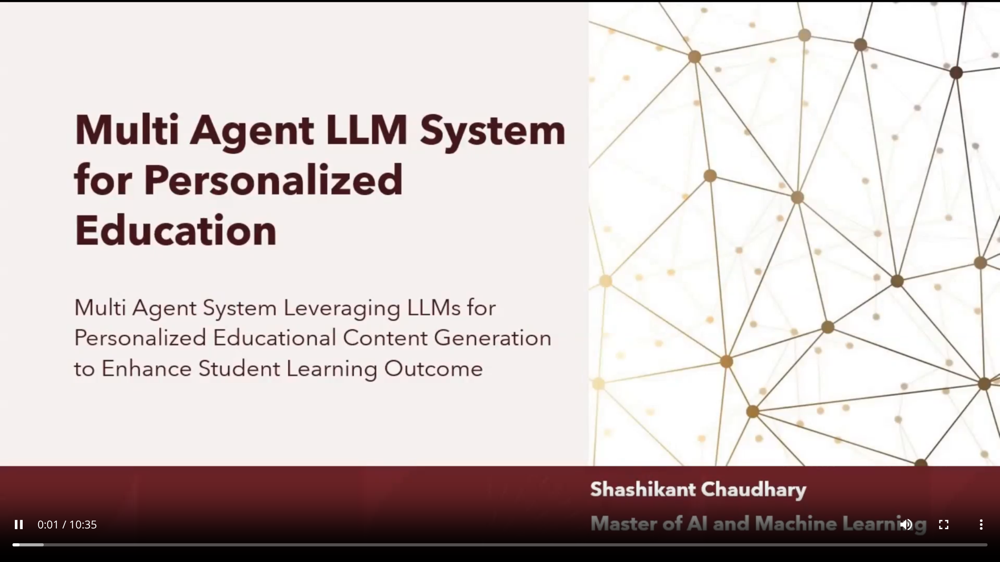

# Multi-agent LLM system for personalised education

**Course:** Artificial Intelligence and Machine Learning Research Project Part B, University of Adelaide, 2025.

**Assessment:** Final presentation.

**Recorded final-presentation score:** 94 / 100.

**Presenter:** Shashikant Chaudhary.

The attached preview identifies the project as a multi-agent LLM system for personalised educational content generation.

**Available file: preview only.** The export includes this title-slide screenshot, not the full video, slide deck, report, or source code. The 94 / 100 mark belongs to the complete final presentation, not to this preview image. No missing submission has been reconstructed or substituted.

[Open the original preview image](final-presentation-preview.png) · [Back to coursework](../README.md)
